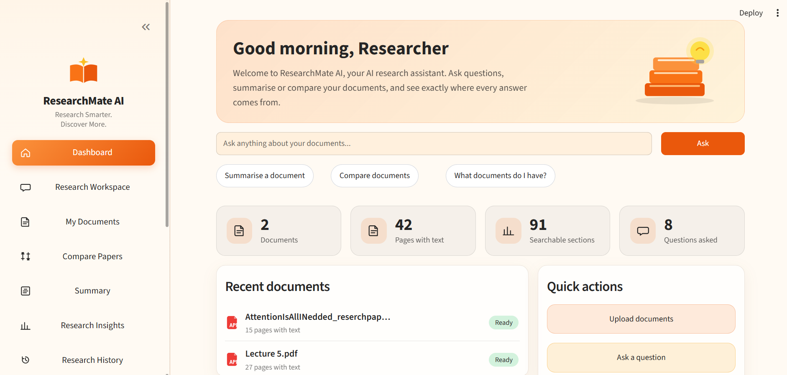
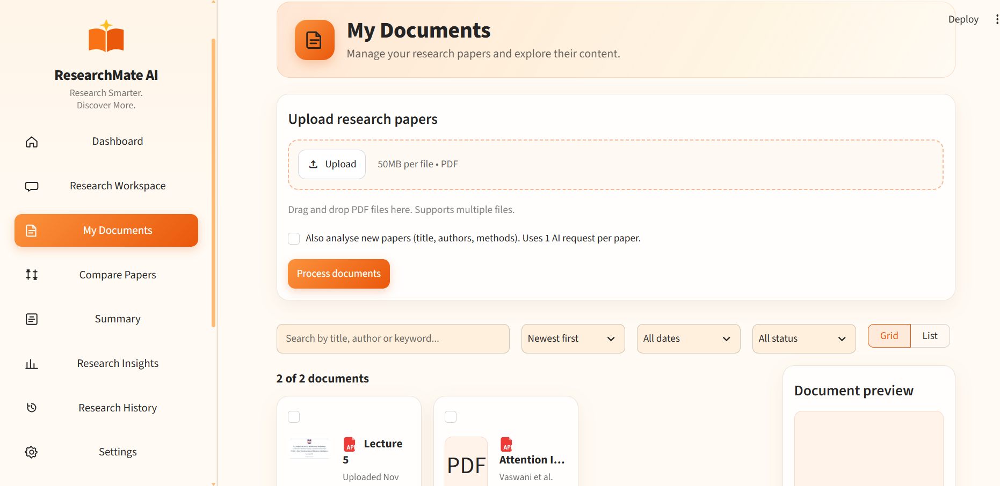
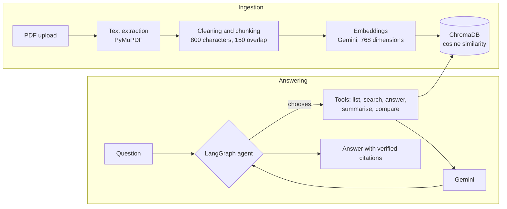
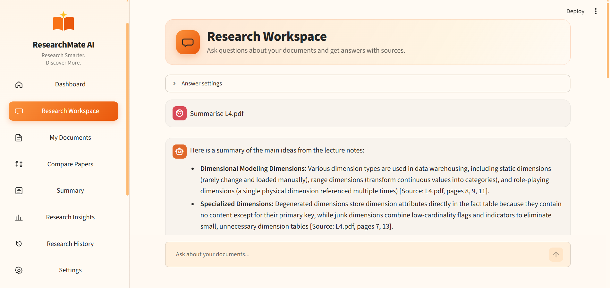

# ResearchMate AI

**An AI research assistant that reads your PDFs, answers questions with page-level citations, summarises documents and compares papers.**

Built with Python, Streamlit, Google Gemini, ChromaDB and LangGraph. Individual project by a BSc (Hons) Information Technology (Data Science) undergraduate at SLIIT.



---

## Features

- **Multi-document upload.** Add several PDFs, preview them, download them again and delete them from the **My Documents** page.
- **Question answering with sources.** Answers are generated only from your documents. Every answer cites the file and page it came from, and each citation is checked against the stored document.
- **Honest refusals.** If the documents do not contain the answer, the assistant says so instead of guessing.
- **A tool-using agent.** A LangGraph agent decides which tool to use (search, answer, summarise, compare, list documents) and the interface shows which tools it used.
- **Summaries and comparisons.** Summarise a whole document, or compare two documents on a topic, with cited sources.
- **Paper analysis.** On request, extract a paper's title, authors, year, methods, results, limitations, topics and research gaps.
- **Two answer styles.** *Smart assistant* (the agent chooses tools) and *Quick answer* (one search, one answer).
- **Activity and library views.** A dashboard with real library statistics, plus Research Insights and Research History pages built from your actual activity.
- **Light and dark themes**, switchable from Streamlit's menu.



---

## How it works



**Ingestion.** Text is extracted page by page, cleaned (repeated headers and footers are removed, hyphenated line breaks are joined) and split into overlapping chunks. Chunks never cross a page boundary, so every chunk keeps an exact page number for citations. Each chunk is embedded and stored in ChromaDB with its file name and page.

**Retrieval-augmented generation (RAG).** A question is embedded, and the six most similar chunks are retrieved. Chunks below a similarity threshold (0.6) are discarded. If nothing relevant remains, the app refuses without calling the language model. Otherwise the chunks are placed in a prompt that tells Gemini to answer only from them and to cite `[Source: file, page N]`.

**Two safeguards against unsupported answers.** The similarity threshold (in code) and the prompt instruction (in the model). Citations are then parsed from the answer and looked up in the stored documents. A citation to a file or page that does not exist is flagged in the interface.

**The agent.** A LangGraph graph with a model node, a tools node and a conditional edge: if the model asks for a tool, the tool runs and its result goes back to the model, otherwise the answer is returned. A step cap (6) stops runaway loops, which also protects the free-tier quota.

| Tool | What it does |
|---|---|
| `list_documents` | Lists the stored documents |
| `search_documents` | Returns the most relevant passages for a topic |
| `answer_from_documents` | Returns a cited answer to one self-contained question |
| `summarize_document` | Summarises one whole document |
| `compare_documents` | Searches each of two documents separately, then compares them |

## Tech stack

| Area | Technology |
|---|---|
| Language | Python 3.13 |
| Interface | Streamlit with custom CSS |
| LLM | Google Gemini API (`gemini-3.5-flash-lite`, fallback `gemini-3.1-flash-lite`) |
| Embeddings | `gemini-embedding-001`, 768 dimensions |
| Vector database | ChromaDB (persistent, cosine similarity) |
| Agent | LangGraph, LangChain (Gemini connector and text splitter) |
| PDF processing | PyMuPDF |

---

## Getting started

### Prerequisites
- Python 3.13 (the version this project was developed and tested on)
- A free Gemini API key from [Google AI Studio](https://aistudio.google.com)

### Install
```bash
git clone https://github.com/kavishka-devindi/researchmate-ai.git
cd researchmate-ai

# create and activate a virtual environment
python -m venv venv
venv\Scripts\activate          # Windows (PowerShell)
# source venv/bin/activate     # macOS / Linux

pip install -r requirements.txt
```

### Configure
Copy `.env.example` to `.env` and put your key in it:
```
GEMINI_API_KEY=your_api_key_here
```
`.env` is listed in `.gitignore`, so your key is never committed.

### Run
```bash
streamlit run app.py
```
Open the address shown in the terminal (normally http://localhost:8501).

### Use it
1. Open **My Documents**, upload one or more PDFs and click **Process documents**.
2. Open **Research Workspace** and ask a question, or use **Summary** and **Compare Papers**.
3. Expand **How I found this answer** to see which tools the agent used, and **Sources** to read the cited passages.

Sample questions: "What is the main contribution of this paper?", "Summarise this document", "Compare these two papers on their methodology", "What are the limitations the authors mention?"

**Example** (from the Attention Is All You Need paper; file name shortened):

> **Q:** What is the Transformer architecture based on?
> **A:** The Transformer architecture is based solely on attention mechanisms, dispensing with recurrence and convolutions entirely [Source: paper.pdf, page 1].



---

## Project structure

```
app.py                 Streamlit entry point
src/
  config.py            settings and model names
  llm.py               Gemini calls with retry and fallback model
  pdf_processing.py    extraction, cleaning, chunking
  vector_store.py      embeddings and ChromaDB
  rag.py               retrieval and grounded answer generation
  tools.py             the agent's tools
  agent.py             the LangGraph agent and citation checking
  analysis.py          paper analysis (title, authors, methods, ...)
  storage.py           saved PDF copies, previews
  history.py           activity log
ui/                    Streamlit pages, styling and shared components
tests/
  eval_questions.json  evaluation questions with expected pages
  run_eval.py          evaluation script
  results/             generated reports
```

---

## Evaluation

The assistant is evaluated with a small question set (`tests/eval_questions.json`): **22 questions over two documents**, a lecture slide deck and the *Attention Is All You Need* paper. Seventeen are answerable (including paraphrased, detail, list, summary and document-listing questions) and five are unanswerable (unrelated, or on-topic but absent from the documents). Expected pages were chosen by hand.

```bash
python -m tests.run_eval --pause 8
```

| Measure | Run 1 | Run 2 |
|---|---|---|
| Retrieval: expected page in top 6 | 14/15 | 14/15 |
| Retrieval: mean reciprocal rank | 0.75 | 0.75 |
| Direct RAG: answered when answerable | 15/15 | 15/15 |
| Direct RAG: refused when unanswerable | 5/5 | 5/5 |
| Direct RAG: citations pointing to a real page | 32/32 | 38/39 |
| Direct RAG: citations found in the retrieved passages | 32/32 | 38/39 |
| Direct RAG: expected page cited | 14/15 | 13/15 |
| Agent: answered when answerable | 17/17 | 17/17 |
| Agent: refused when unanswerable | 5/5 | 5/5 |
| Agent: citations pointing to a real page | 59/59 | 53/53 |
| Agent: expected page cited | 14/15 | 12/15 |
| Agent: acceptable tool chosen | 22/22 | 22/22 |
| Median / slowest response, Direct RAG | not measured | 1.9 s / 3.8 s |
| Median / slowest response, Agent | not measured | 4.6 s / 29.7 s |
| Answer faithfulness (judged by hand) | _fill in_ | _fill in_ |

**Reading these numbers.** Retrieval is deterministic, but answers are not: the same questions gave different citation results on two runs, so the answer-level rows are shown as two runs rather than one number. "Expected page cited" and "citation pointing to a real page" check where an answer points, not whether each claim is actually on that page. That is what the manual faithfulness check is for.

---

## Limitations

- **Small, self-written evaluation set.** Twenty-two questions over two documents, mostly single-page lookups, written by the developer. These results do not show how the system performs on other documents or on harder questions.
- **Citations are not perfectly reliable.** In one run, one of 39 citations pointed to a page that does not exist. The interface flags citations it cannot verify, but the model can still cite the wrong page.
- **Retrieval does not always rank the right page first** (mean reciprocal rank 0.75). A weak match can appear above the best one.
- **Plain search cannot answer whole-document questions.** *Quick answer* mode retrieves six passages, so a summary built that way is partial. The agent's summarise tool exists for this reason.
- **Text-based PDFs only.** Scanned PDFs are rejected with a clear message, because there is no OCR. Tables, figures and equations are not understood.
- **No conversation memory.** Each question is answered on its own, so a follow-up such as "and the second one?" does not work.
- **Language.** Only English questions have been evaluated.
- **Free-tier constraints.** Gemini's free tier has small request limits (the agent can use several requests per question), and on the free tier prompts may be used by Google to improve its products. Do not upload private or sensitive documents.
- **Single-user, local app.** There is no authentication, and all data is stored in one local workspace.

## Possible improvements

Re-ranking retrieved passages, hybrid keyword and semantic search, OCR for scanned PDFs, conversation memory passed to the agent, a larger evaluation set on public papers, a per-user workspace for deployment.

## Privacy and data

Uploaded PDFs, the vector database, the activity log and analysis results are stored locally in the `data/` folder, which is excluded from Git. Text from your documents is sent to the Gemini API to generate embeddings and answers.

## Author

Built by [@kavishka-devindi](https://github.com/kavishka-devindi).